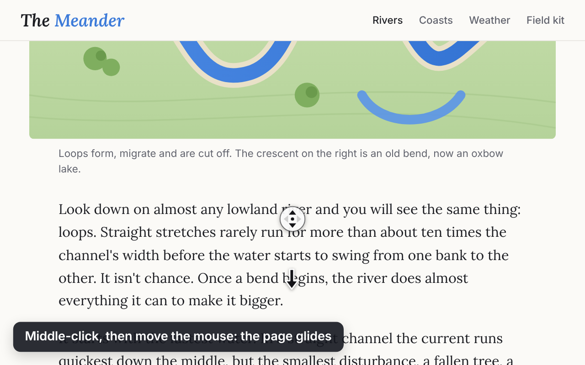

# Glide Autoscroll

**Middle-click autoscroll for Chrome, Brave and other Chromium browsers on Linux.**
Press the mouse wheel, move the mouse, and the page glides. Works on Mac too.



## Why this exists

On Windows, every Chromium browser has middle-click autoscroll: press the scroll wheel on a
page, move the mouse, and the page scrolls in that direction until you click again. On Linux,
Chrome, Brave and Chromium don't do this. Middle-click on a page does nothing, or pastes
whatever text you last selected.

Firefox has the feature built in (switched off by default on Linux, under Settings → General →
Browsing → "Use autoscrolling"), but Chromium-based browsers don't offer it in their settings.

There are already extensions in the Chrome Web Store that set out to add it, and Glide exists
because they fell short in everyday use: scrolling that felt jerky, no way to scroll the inner
panels most modern sites are built from (sidebars, chat and mail lists, code panels), or Linux's
middle-click paste going off when a scroll started or stopped. Rather than live with that, Glide
was written from scratch to get those things right.

If you landed here searching for something like *middle mouse button scrolling not working on
Linux*, *autoscroll in Brave on Ubuntu / Fedora / Arch / Mint*, or *Windows-style middle-click
scroll in Chrome on Linux*, this is that.

## Install

- **Chrome Web Store**: coming soon. Brave, Edge, Vivaldi and Opera can install from there too.
- **From this repository** (no automatic updates):
  1. Download the code (green **Code** button, **Download ZIP**) and unzip it, or `git clone` it.
  2. Open `chrome://extensions` (in Brave, `brave://extensions`) and turn on **Developer mode**.
  3. Click **Load unpacked** and choose the `glide-autoscroll` folder inside the download.

## Using it

- **Middle-click and move.** The further from the start point, the faster it goes. Move back
  to the start point to stop.
- **Click once** and it keeps gliding until you click again, or **hold and drag** and it stops
  when you let go.
- It scrolls **whatever is under the pointer**: the page, a sidebar, a chat or mail list, a
  code panel, a carousel, an embedded frame.
- Middle-click on a **link** still opens it in a new tab, and middle-click **paste into text
  boxes** still works. Starting or stopping a glide never pastes.
- Hold **Ctrl** or **Shift** for the browser's normal middle-click. **Esc**, any click, any key or
  the scroll wheel stops a glide.
- The toolbar button switches it off for the site you're on. The settings page has speed,
  acceleration, dead zone and click style, with a test area to try them out.

## The built-in alternative

Chromium does have its own autoscroll on Linux, hidden behind a launch flag:

```sh
google-chrome --enable-blink-features=MiddleClickAutoscroll
```

It worked in Chrome 153 on Linux when tested in November 2026. It's undocumented and could
change, it has no settings, and it only applies when the browser is started with the flag. On
Arch-based distributions the browser packages usually read flags from a file such as
`~/.config/chrome-flags.conf` or `~/.config/brave-flags.conf`. If that suits you, you don't need
Glide. If both are on, Glide handles the click.

## Privacy

Glide has no servers and makes no network requests. Settings stay in your browser's extension
storage. Details in [PRIVACY.md](PRIVACY.md).

## Browser support

| Browser | |
|---|---|
| Chrome on Linux | Tested |
| Brave, Edge, Vivaldi, Opera | Chromium-based, should work; not yet tested |
| Chrome on Mac | Should work; not yet tested |
| Chrome on Windows | Has autoscroll built in. Glide should take over from it, as it does from the built-in one on Linux; not yet tested |
| Firefox, Safari | Not supported (Firefox has its own, see above) |

## Project layout

| Folder | What's in it |
|---|---|
| [`glide-autoscroll`](glide-autoscroll) | The extension itself (Manifest V3, no dependencies, no build step) |
| [`glide-autoscroll-tests`](glide-autoscroll-tests) | Browser tests that drive real middle-clicks in Chrome, plus lint and the store build scripts |
| [`glide-autoscroll-store`](glide-autoscroll-store) | Chrome Web Store listing text, images and the pages the screenshots are taken on |

```sh
cd glide-autoscroll-tests
npm install
npm test        # about 4 minutes, headless
```

Bug reports and ideas: [open an issue](https://github.com/nedsexps/glide-autoscroll-linux/issues).

## Licence

[MIT](LICENSE)
